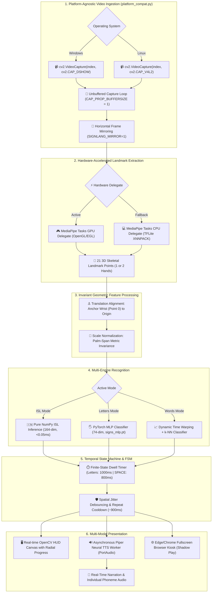

<div align="center">

```
  ███████╗██╗ ██████╗ ███╗   ██╗██╗      █████╗ ███╗   ██╗ ██████╗ 
  ██╔════╝██║██╔════╝ ████╗  ██║██║     ██╔══██╗████╗  ██║██╔════╝ 
  ███████╗██║██║  ███╗██╔██╗ ██║██║     ███████║██╔██╗ ██║██║  ███╗
  ╚════██║██║██║   ██║██║╚██╗██║██║     ██╔══██║██║╚██╗██║██║   ██║
  ███████║██║╚██████╔╝██║ ╚████║███████╗██║  ██║██║ ╚████║╚██████╔╝
  ╚══════╝╚═╝ ╚═════╝ ╚═╝  ╚═══╝╚══════╝╚═╝  ╚═╝╚═╝  ╚═══╝ ╚═════╝ 
```

### ⚡ Real-Time Edge ISL & ASL Recognition Engine
**Offline • Two-Handed ISL • ASL Fingerspelling • Dynamic Words • Browser Shadow-Play Dino Game**

[](https://python.org)
[](#-quickstart--zero-prerequisite-installers)
[](.github/workflows/ci.yml)
[](https://pytorch.org)
[](https://developers.google.com/mediapipe)
[](#-cross-platform-hardware-acceleration)
[](https://github.com/rhasspy/piper)
[](#-rigorous-evaluation--empirical-benchmarks)
[](LICENSE)

---

</div>

## 📌 Executive Summary

**SignLang** is a high-throughput, edge-native sign language translation engine with **Indian Sign Language (ISL)** as its primary mode alongside American Sign Language (ASL) fingerspelling, dynamic word-sign translation, and an interactive browser shadow-play game.

Engineered to operate seamlessly on **both Windows 10/11 and Linux** (including bare, fresh laptops with low-end 2-core CPUs and ~4 GB RAM), SignLang features an active GPU delegate (OpenGL/EGL) with CPU fallback, native **DirectShow** (Windows) and **V4L2** (Linux) capture pipelines, and an asynchronous offline Piper Neural Text-to-Speech (TTS) engine.

```
┌────────────────────────────────────────────────────────────────────────────────────────┐
│                               🚀 CORE ARCHITECTURAL PILLARS                            │
├────────────────────────────────────────────────────────────────────────────────────────┤
│  🇮🇳  Primary ISL Two-Hand Mode     │ Standardized on ISLRTC 2-handed manual alphabet   │
│  🖐️  ASL Fingerspelling (Letters) │ 26 classes (A–Y + custom SPACE) with dwell ring    │
│  📈  ASL Dynamic Words (Words)    │ Temporal sequence recognition via DTW + k-NN       │
│  🦖  Sign Dino Shadow-Play Game   │ Fullscreen browser kiosk game at localhost:8000    │
│  🪟  First-Class Windows Support  │ DirectShow (cv2.CAP_DSHOW), Edge/Chrome kiosk      │
│  ⚡  Zero-Prereq Bootstrap Wizard │ 1-liner PowerShell install + interactive Rich TUI  │
│  🩺  System Doctor (Self-Test)    │ Integrated diagnostic suite (signlang doctor)      │
│  🔒  Strict Biometric Privacy     │ 100% offline; zero images or video stored on disk  │
└────────────────────────────────────────────────────────────────────────────────────────┘
```

---

## ⚡ Quickstart — Zero-Prerequisite Installers

### 🪟 Windows 10 / 11 (Automated PowerShell One-Liner)

On a fresh, bare Windows laptop (no Python, no Git, and no admin rights needed), open **PowerShell** and run:

```powershell
irm https://raw.githubusercontent.com/RAZOR-NINJAS/signlang/main/install.ps1 | iex
```

<details>
<summary><b>🔍 What this automated bootstrap does under the hood</b></summary>

1. **Python 3.11 Auto-Resolution**: Checks for Python 3.11. If absent, installs via non-admin `winget` or downloads official Python 3.11 with `/quiet InstallAllUsers=0 PrependPath=1`.
2. **Git & Repository Extraction**: Clones via Git, or downloads and extracts the release ZIP using PowerShell `Expand-Archive`.
3. **Isolated Virtual Environment**: Creates `.venv`, upgrades pip, and installs all dependencies in editable mode (`pip install -e .` + `rich`).
4. **Model Bundle Fetch**: Automatically fetches `hand_landmarker.task` (~7.8 MB) and Piper neural voice ONNX (~61 MB).
5. **Interactive TUI Wizard**: Launches the gradient ASCII installer, probes webcams, configures modes, creates **Desktop** & **Start Menu** shortcuts (`SignLang.lnk`), and runs the self-test.
6. **Desktop Launcher**: Double-click `signlang.bat` anytime to launch!

</details>

---

### 🐧 Linux (Arch / Omarchy / Ubuntu / Debian / macOS)

Run the native Linux bootstrap script:

```bash
git clone https://github.com/RAZOR-NINJAS/signlang.git
cd signlang
./install.sh
```

---

### 💻 Manual Installation (Step-by-Step)

<details>
<summary><b>Manual Windows (PowerShell / Command Prompt)</b></summary>

```powershell
# 1. Clone source repository
git clone https://github.com/RAZOR-NINJAS/signlang.git
cd signlang

# 2. Initialize Python 3.11 virtual environment
py -3.11 -m venv .venv
.\.venv\Scripts\Activate.ps1

# 3. Install dependencies
python -m pip install --upgrade pip
pip install -e .
pip install rich

# 4. Fetch MediaPipe landmarker and Piper TTS models
python scripts\fetch_models.py

# 5. Run diagnostic healthcheck
python main.py doctor

# 6. Launch SignLang (ISL primary mode)
.\signlang.bat
```

</details>

<details>
<summary><b>Manual Linux / macOS (Terminal)</b></summary>

```bash
# 1. Clone source repository
git clone https://github.com/RAZOR-NINJAS/signlang.git
cd signlang

# 2. Initialize virtual environment (Python 3.11 or 3.12)
python3 -m venv .venv
source .venv/bin/activate

# 3. Install in editable mode
pip install --upgrade pip
pip install -e .
pip install rich

# 4. Fetch models
python scripts/fetch_models.py

# 5. Run diagnostic healthcheck
python main.py doctor

# 6. Launch SignLang
python main.py
```

</details>

---

## 🎨 Interactive Setup Wizard & System Doctor

### 1. Interactive Setup Wizard (`scripts/install_tui.py`)

Run `python scripts/install_tui.py` (or `python scripts/install_tui.py --yes` for silent unattended installs):

```
  ███████╗██╗ ██████╗ ███╗   ██╗██╗      █████╗ ███╗   ██╗ ██████╗ 
  ██╔════╝██║██╔════╝ ████╗  ██║██║     ██╔══██╗████╗  ██║██╔════╝ 
  ███████╗██║██║  ███╗██╔██╗ ██║██║     ███████║██╔██╗ ██║██║  ███╗
  ╚════██║██║██║   ██║██║╚██╗██║██║     ██╔══██║██║╚██╗██║██║   ██║
  ███████║██║╚██████╔╝██║ ╚████║███████╗██║  ██║██║ ╚████║╚██████╔╝
  ╚══════╝╚═╝ ╚═════╝ ╚═╝  ╚═══╝╚══════╝╚═╝  ╚═╝╚═╝  ╚═══╝ ╚═════╝ 

       Real-Time Sign Language Translator (ISL • ASL • Words • Shadow Play)

┌────────────────────────┬─────────────────────────────────────────────────────┐
│ Operating System       │ Windows 10/11 (win32, x86_64)                       │
│ Python Runtime         │ 3.11.9 (C:\Users\User\Projects\signlang\.venv)     │
│ Video Backend          │ DirectShow (cv2.CAP_DSHOW)                          │
│ Kiosk Browser          │ msedge.exe                                          │
└────────────────────────┴─────────────────────────────────────────────────────┘
```

---

### 2. Comprehensive System Doctor (`signlang doctor`)

Run `python main.py doctor` or `signlang doctor` anytime to evaluate system health:

```
=== SignLang System Doctor & Compatibility Diagnostics ===

┏━━━━━━━━━━━━━━━━┳━━━━━━━━━━━━━━━━━━━━━━━━━━━━┳━━━━━━━━━━━━┳━━━━━━━━━━━━━━━━━━━━━━━━━━━━┓
┃ Category       ┃ Component                  ┃ Status     ┃ Details                    ┃
┡━━━━━━━━━━━━━━━━╇━━━━━━━━━━━━━━━━━━━━━━━━━━━━╇━━━━━━━━━━━━╇━━━━━━━━━━━━━━━━━━━━━━━━━━━━┩
│ Environment    │ Python Runtime             │ PASS       │ 3.11.9 (venv active)       │
│ Environment    │ Operating System           │ PASS       │ Windows 11 (DirectShow)    │
│ Hardware       │ Webcam Capture             │ PASS       │ Cam 0 (640x480) unbuffered │
│ Vision         │ MediaPipe Landmarker       │ PASS       │ Tasks API verified         │
│ Models         │ ISL Mode (Two-Handed)      │ PASS       │ Trained weights present    │
│ Models         │ ASL Letters Mode           │ PASS       │ signs_mlp.pt present       │
│ Models         │ ASL Words Mode             │ PASS       │ Classifier present         │
│ Audio          │ Text-to-Speech (Piper)     │ PASS       │ Piper ONNX & Audio output  │
│ Display        │ Browser Kiosk (Game Mode)  │ PASS       │ Detected: msedge.exe       │
│ Network        │ Localhost Loopback         │ PASS       │ Loopback socket verified   │
└────────────────┴────────────────────────────┴────────────┴────────────────────────────┘
All core systems are operational and ready for use!
```

> **Automated CI Validation**: Run `python main.py doctor --check-only` for silent exit-code-based verification in scripts and GitHub Actions.

---

## 🏛️ End-to-End System Architecture



---

## 🎯 Operational Subsystems & Modes

### 1. Indian Sign Language (ISL Mode — Primary Default)
* **Default Invocation**: `python main.py` or double-clicking `signlang.bat`.
* **Standard Grounding**: Based on the standardized manual alphabet established by the **Indian Sign Language Research and Training Centre (ISLRTC)**, DEPwD, Govt. of India.
* **Dual-Hand Tracking**: Configures MediaPipe Tasks API with `num_hands=2` to track both hands simultaneously.
* **Movement-Free Static Words**: Recognizes iconic ISL word gestures:
  * **NAMASTE** (2 hands): Flat palms joined vertically at chest in traditional prayer/greeting.
  * **GOOD** (1 hand): Thumbs-up gesture with all other fingers curled into a fist.
  * **BAD** (1 hand): Pinky extended upright (*katti* gesture) with all other fingers curled.
  * **PEACE** (1 hand): V-sign with index and middle fingers extended upright.
  * **OK** (1 hand): Thumb and index fingertips touching in a ring, other 3 fingers extended.
  * **HOUSE** (2 hands): Fingertips of both flat hands touching at an angle forming a triangular roof.
  * **BOOK** (2 hands): Both open palms facing upward touching pinky edges side-by-side.
  * **TIME** (2 hands): Dominant index finger touching the back of the base wrist.
  * **LOVE** (1 hand): Thumb, index, and pinky fingers extended upright (I-Love-You gesture).
  * **STOP** (1 hand): Open flat palm facing forward toward camera.
* **164-Dimensional Feature Representation**: Canonicalizes hand slots (`slot_left`, `slot_right`), computes 74 invariant geometric features per hand, zero-imputes absent hands, adds 14 inter-hand interaction features (wrist offset, inter-palm distance, fingertip proximities), and 2 hand-presence indicator flags.
* **Pure NumPy Live Inference**: Executes live HUD classification via an ultra-fast NumPy forward pass (`<0.05 ms`), eliminating PyTorch memory and thermal overhead on constrained laptops.

---

### 2. Static ASL Fingerspelling (Letters Mode)
* **Invocation**: `python main.py --mode letters`
* **Coverage**: Recognizes 26 discrete classes—letters **A through Y** plus **custom SPACE gesture**.
* **Model Topology**: Feed-forward neural network trained on 10,570+ samples with class-weighted cross-entropy loss.
* **Accuracy Standard**: Attains **100.0% validation accuracy** under strict burst-held-out cross-validation.
* **Circular Dwell Indicator**: A dynamic visual progress ring tracks hold duration before committing the character to the live transcript.

---

### 3. Holistic ASL Words Mode (Dynamic Signs)
* **Invocation**: `python main.py --mode words live`
* **Coverage**: Dynamic sequence signs (*HELLO, THANKYOU, PLEASE, YES, NO, HELP, MORE, FINISHED, etc.*).
* **Algorithmic Baseline**: Time-series alignment via Dynamic Time Warping (DTW) combined with $k$-Nearest Neighbors ($k$-NN).
* **Motion-Energy Gating**: Continuously monitors kinetic energy to delineate the start and end of sign gestures.

---

### 4. Interactive Browser Shadow-Play Game (`Sign Dino`)
* **Invocation**: `python main.py --mode game` (or `python main.py --mode game --kiosk` for fullscreen kiosk mode).
* **Mechanism**: Chrome Dino-style obstacle runner game hosted via Python's standard library HTTP server at `http://localhost:8000`.
* **Kiosk Launcher**: Automatically launches **Microsoft Edge** (`msedge.exe`) or **Google Chrome** in `--app` or `--kiosk` fullscreen mode without address bars or distractions.
* **Mobile / Tablet Streaming**: Run `python main.py --mode game --host=0.0.0.0 --port=8080` to play on phones or iPads over local Wi-Fi while your computer's webcam tracks hand gestures.

<div align="center">

| 🎮 Active Challenge: Sign to Leap | 💥 Collision & Diagnostic Analysis |
| :---: | :---: |
|  |  |

</div>

---

### 5. Asynchronous Neural Text-to-Speech Engine
* **Synthesis Engine**: Offline neural speech generation powered by Piper ONNX (`en_US-lessac-medium.onnx`).
* **Zero-Latency In-Memory Audio Cache**: Pre-synthesizes letter pronunciations (A–Z, SPACE, BACKSPACE) into RAM during initialization, eliminating audio buffer latency during live signing.
* **Full Transcript Narration**: Pressing **`R`** triggers immediate synthesis and playback of the entire accumulated text buffer.

---

## ⌨️ Controls & Gesture Cheat Sheet

| Gesture / Shortcut | Formal Description | State Machine Behavior |
| :--- | :--- | :--- |
| **Static Letter Sign** | Hold single sign stationary | Advances circular dwell progress ring (~1.0s); appends letter; triggers cached audio playback. |
| **Open Flat Palm (SPACE)** | Open hand, 5 extended spread fingers | Dwells for ~0.8s (`SPACE_DWELL_MS`); appends one space (`" "`); speaks *"space"*; enforces hold-once latching. |
| **Space Repeat Cooldown** | Drop/relax hand after SPACE sign | Enforces a ~900ms cooldown window before a subsequent SPACE gesture can be registered. |
| **Horizontal Swipe Right** | Rapid hand translation to the right | Velocity threshold triggers space character insertion. |
| **Horizontal Swipe Left** | Rapid hand translation to the left | Velocity threshold deletes the preceding character from the transcript buffer. |
| **`R` Key** | Read Transcript | Commands Piper TTS engine to narrate the entire accumulated transcript buffer aloud. |
| **`C` Key** | Clear Transcript | Clears the live text transcript, resets history, and clears debouncer memory. |
| **`Backspace` Key** | Manual Erase | Deletes the last character in the buffer. |
| **`F` Key** | Fullscreen Toggle | Toggles runtime fullscreen mode without aspect ratio distortion or pixel scaling defects. |
| **`Q` / `Esc` Key** | Graceful Termination | Releases camera descriptors, closes OpenCV windows, and safely joins TTS worker threads. |

---

## 📊 Rigorous Evaluation & Empirical Benchmarks

Validation protocols account for temporal burst correlation, ensuring realistic accuracy metrics:

| Diagnostic Benchmark | Execution Command | Empirical Result | Methodology & Notes |
| :--- | :--- | :---: | :--- |
| **Full Regression Suite** | `pytest` | **103 / 103 Passed** | Covers debounce logic, doctor checks, ASL zero-regression, words DTW, and ISL two-hand features & HUD. |
| **Letters (Honest Burst Hold-Out)** | `python eval_burst.py` | **100.0% Accuracy** | Evaluates 10,570 frames across 755 unseen bursts; prevents data leakage from adjacent frames. |
| **Live Overlay Render Invariance** | `python -m signlang.test_live_layout` | **84 / 84 Passed** | Evaluates 6 frame resolutions across 14 UI state variations to confirm zero text clipping or collision. |
| **Words Classification Latency** | `python main.py --mode words eval` | **~20.1 ms / sample** | Dynamic Time Warping (DTW) sequence alignment latency on standard hardware. |
| **ISL Dual-Hand Landmark Extraction** | `python main.py --mode isl live` | **26.0 ms (GPU) / 69.1 ms (CPU)** | Measured on HP 15 laptop (`num_hands=2`); preserves zero regression vs ASL 1-hand baseline (26.1 ms GPU). |
| **ISL Live Forward Inference** | `Predictor.probs()` | **< 0.05 ms / sample** | Pure NumPy forward pass; zero PyTorch memory or thermal overhead during live execution. |

---

## ⚙️ Environment Configuration Reference

The application behavior can be customized via environment variables:

| Environment Variable | Default | Formal Description & Impact |
| :--- | :---: | :--- |
| `SIGNLANG_GPU` | `1` | Enables MediaPipe GPU acceleration via OpenGL/EGL delegate (~2.6× speedup). Set to `0` to force CPU execution. |
| `SIGNLANG_CAMERA` | `0` | Specifies the numeric hardware device index for video capture. |
| `SIGNLANG_SOURCE` | — | Overrides camera index with an explicit OpenCV stream URI (e.g., HTTP MJPEG stream from IP webcam). |
| `SIGNLANG_WIDTH` / `HEIGHT`| `640` / `480` | Native capture dimensions requested from the video capture driver. |
| `SIGNLANG_DETECT_HEIGHT` | `480` | Target vertical resolution for landmark extraction (accuracy scales with resolution). |
| `SIGNLANG_DETECT_EVERY` | `1` | Runs landmark detection every Nth frame, reusing cached coordinates in between to increase framerate. |
| `SIGNLANG_DOMINANT` | `right` | Dominant hand for ISL signing (`right` or `left`). Mapped canonically with mirror augmentation for left-handed signers. |
| `SIGNLANG_TTS` | `1` | Enables real-time text-to-speech audio feedback. Set to `0` to run in silent mode. |
| `SIGNLANG_MIRROR` | `1` | Horizontally mirrors video feed to provide a natural selfie mirror view. Set to `0` to disable. |
| `SIGNLANG_MAX_HANDS` | `1` | Maximum concurrent hands tracked (automatically set to `2` in ISL mode). |

---

## 📜 License

Distributed under the terms of the **MIT License**. Refer to [`LICENSE`](LICENSE) for complete legal terms.

<div align="center">
<sub>Engineered with ❤️ by RAZOR-NINJAS for accessible, real-time sign language recognition on everyday edge hardware.</sub>
</div>
