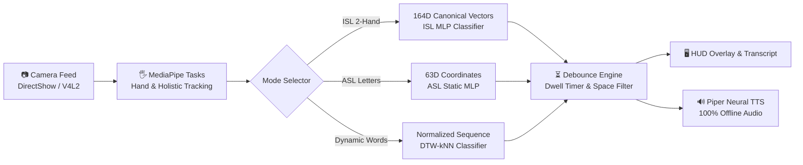
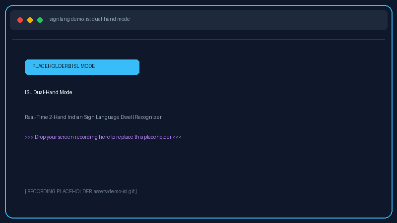
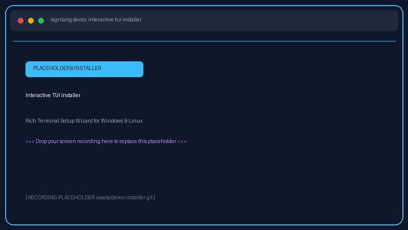

<div align="center">

```
  ███████╗██╗ ██████╗ ███╗   ██╗██╗      █████╗ ███╗   ██╗ ██████╗ 
  ██╔════╝██║██╔════╝ ████╗  ██║██║     ██╔══██╗████╗  ██║██╔════╝ 
  ███████╗██║██║  ███╗██╔██╗ ██║██║     ███████║██╔██╗ ██║██║  ███╗
  ╚════██║██║██║   ██║██║╚██╗██║██║     ██╔══██║██║╚██╗██║██║   ██║
  ███████║██║╚██████╔╝██║ ╚████║███████╗██║  ██║██║ ╚████║╚██████╔╝
  ╚══════╝╚═╝ ╚═════╝ ╚═╝  ╚═══╝╚══════╝╚═╝  ╚═╝╚═╝  ╚═══╝ ╚═════╝ 
```

<picture>
  <source media="(prefers-color-scheme: dark)" srcset="assets/banner-dark.svg">
  <source media="(prefers-color-scheme: light)" srcset="assets/banner-light.svg">
  
</picture>

### Real-time sign language recognition that runs entirely on your machine.
**No cloud. No accounts. No uploads. Just a webcam and your hands.**


<br/>

[](https://github.com/RAZOR-NINJAS/SignLang/actions)
[](https://www.python.org/)
[](#quick-install)
[](#why-signlang)
[](#low-spec-optimization)
[](LICENSE)
[](https://github.com/RAZOR-NINJAS/SignLang/stargazers)

[**⚡ Install**](#quick-install) &nbsp;•&nbsp;
[**🎯 Modes**](#modes) &nbsp;•&nbsp;
[**👀 Live Preview**](#live-preview) &nbsp;•&nbsp;
[**🧠 How It Works**](#how-it-works) &nbsp;•&nbsp;
[**🎮 Controls**](#controls) &nbsp;•&nbsp;
[**🔍 Doctor**](#doctor) &nbsp;•&nbsp;
[**🎬 Gallery**](#gallery)

<br/>


</div>


<a id="why-signlang"></a>
## 💡 Why SignLang?

Most sign-recognition demos stream your camera to a server. SignLang does the opposite: **everything happens on your device.**

```text
   YOUR MACHINE   ┌───────────────────────────────────────────────────────┐
                  │  camera ─▶ landmarks ─▶ classifier ─▶ text ─▶ voice   │
                  └───────────────────────────────────────────────────────┘
   ░░░░░░░░░░░░░░░░░░░░░░░░░░░░░░░░░░░░░░░░░░░░░░░░░░░░░░░░░░░░░░░░░░░░░░░░░░
   THE INTERNET      ·   ·   nothing ever crosses this line   ·   ·
```

| | ☁️ Typical cloud approach | 🤟 SignLang |
| :--- | :--- | :--- |
| **Latency** | Network round trip on every frame | Under 30 ms per frame, locally |
| **Privacy** | Video leaves your device | Frames stay in local RAM, never streamed or stored |
| **Internet** | Required | Not required, including speech output |
| **Hardware** | Server-grade GPUs | Runs on a budget laptop CPU |
| **Setup** | Accounts, keys, billing | One install command |

* ⚡ **Zero cloud latency.** Neural inference runs locally on CPU or GPU.
* 🔒 **Absolute privacy.** 100% offline by design.
* 🪟 **Truly cross-platform.** Native Windows 10/11 (DirectShow) and Linux (V4L2 / Wayland / X11), with zero-prerequisite terminal and TUI installers.


<a id="modes"></a>
## 🎯 Modes & Features

<table width="100%">
  <tr>
    <td width="50%" valign="top">
      <h3>🤲 ISL Two-Handed Mode</h3>
      <p>Official Indian Sign Language alphabet (A–Z) plus 10 static words. Tracks two hands with 164D canonical features and dwell confirmation.</p>
      <code>signlang isl</code>
    </td>
    <td width="50%" valign="top">
      <h3>🔤 ASL Fingerspelling</h3>
      <p>Real-time American Sign Language static letters with high-frequency landmark tracking and instant offline neural TTS playback.</p>
      <code>signlang live</code>
    </td>
  </tr>
  <tr>
    <td width="50%" valign="top">
      <h3>🏃 ASL Dynamic Words</h3>
      <p>Multi-frame holistic body and dual-hand motion sequences, classified with invariant Dynamic Time Warping (DTW-kNN).</p>
      <code>signlang words live</code>
    </td>
    <td width="50%" valign="top">
      <h3>␣ Custom Space Gesture</h3>
      <p>An ergonomic, non-occluding thumb-to-palm touch that inserts spaces without dropping detection confidence.</p>
      <code>Built into all letter modes</code>
    </td>
  </tr>
  <tr>
    <td width="50%" valign="top">
      <h3>🦖 Offline Dino Kiosk Game</h3>
      <p>Play the classic offline runner with hand gestures, launched automatically in fullscreen kiosk mode.</p>
      <code>signlang game --kiosk</code>
    </td>
    <td width="50%" valign="top">
      <h3>🎓 Browser Learning Kiosk</h3>
      <p>An interactive web dashboard at <code>http://localhost:8000</code> with drills, quizzes and live accuracy feedback.</p>
      <code>signlang serve --kiosk</code>
    </td>
  </tr>
</table>

**Dwell confirmation:** a letter only registers once you hold the sign steady, which stops accidental flicker.

```text
   hold a sign steady   ▶   ▱▱▱▱▱▱▱▱     ▰▰▰▱▱▱▱▱     ▰▰▰▰▰▰▱▱     ▰▰▰▰▰▰▰▰  ✔
                              sensing       locking       almost      CONFIRMED  →  "B"
```

### 🧭 Command Cheat Sheet

| I want to... | Run |
| :--- | :--- |
| Check that everything works | `signlang doctor` |
| Recognize Indian Sign Language | `signlang isl` |
| Fingerspell ASL letters | `signlang live` |
| Recognize ASL words | `signlang words live` |
| Learn with drills and quizzes | `signlang serve --kiosk` |
| Play the gesture-controlled game | `signlang game --kiosk` |


<a id="live-preview"></a>
## 👀 Live Preview

<div align="center">
  
</div>

<details>
<summary><b>⌨️ Prefer the terminal-style version?</b></summary>

```text
┌─ signlang live ───────────────────────────────────── ● LIVE ─┐
│                        ╭ ─ ─ ─ ─ ─ ─ ─ ╮     ╭────────╮      │
│   ● CPU delegate       ┆  ◉  ◉  ◉  ◉   ┆     │        │      │
│   ● 21 landmarks       ┆  │  │  │  │   ┆     │   B    │      │
│   ● HUD  [H]           ┆  ●  ●  ●  ●   ┆     │        │      │
│                        ┆  │╲ │  │ ╱│   ┆     │ ▰▰▰▰▱▱ │      │
│                        ┆  ●──●──●──●   ┆     ╰────────╯      │
│                        ┆     ╲ │ ╱     ┆      dwell…         │
│                        ╰ ─ ─ ─ ● ─ ─ ─ ╯                     │
│                                                              │
├──────────────────────────────────────────────────────────────┤
│ TRANSCRIPT  HELLO WORLD▌                                     │
│ [SPACE] space   [C] clear   [S] speak   [Q] quit             │
└──────────────────────────────────────────────────────────────┘
```
</details>

> The preview above is an illustration of the HUD layout. See the [gallery](#gallery) for real recordings.


<a id="quick-install"></a>
## ⚡ Quick Install

Pick your platform and paste one command.

### 🪟 Windows 10 / 11 (PowerShell)
> Automatically handles Python 3.11, Git, virtual environment creation, and launches the interactive setup wizard. **No administrator privileges required.**

```powershell
irm https://raw.githubusercontent.com/RAZOR-NINJAS/SignLang/windows-support/install.ps1 | iex
```

### 🐧 Linux (Bash)
> Supports Ubuntu, Debian, Arch Linux, Omarchy, and Fedora.

```bash
curl -fsSL https://raw.githubusercontent.com/RAZOR-NINJAS/SignLang/windows-support/install.sh | bash
```

### 🚀 Then, in under a minute

```bash
signlang doctor    # verify camera, models, audio
signlang live      # start fingerspelling
```

<details>
<summary><b>🛠️ Manual Installation (Developers & Power Users)</b></summary>

```bash
# 1. Clone repository
git clone https://github.com/RAZOR-NINJAS/SignLang.git
cd SignLang

# 2. Create and activate a Python 3.11 virtual environment
python -m venv .venv
source .venv/bin/activate       # On Linux
# .venv\Scripts\activate        # On Windows

# 3. Install dependencies in editable mode
python -m pip install --upgrade pip
python -m pip install -e .

# 4. Fetch pretrained neural models and weights
python scripts/fetch_models.py

# 5. Verify system readiness
python main.py doctor
```
</details>


<a id="how-it-works"></a>
## 🧠 How It Works

SignLang skips heavy video-transformer architectures. It separates **fast geometric tracking** from **lightweight classification**, which is why it stays real-time on modest hardware.

<div align="center">
  
</div>

<details>
<summary><b>⌨️ Terminal-style pipeline</b></summary>

```text
  ┌────────────┐     ┌──────────────┐     ┌───────────────────┐     ┌────────────┐     ┌──────────────┐
  │            │     │              │     │ ISL    164D · MLP │     │            │     │  HUD + TEXT  │
  │   CAMERA   │ ──▶ │  MEDIAPIPE   │ ──▶ │ ASL     63D · MLP │ ──▶ │  DEBOUNCE  │ ──▶ ├──────────────┤
  │ DShow/V4L2 │     │ 21 pts/hand  │     │ WORDS  DTW · kNN  │     │ dwell+space│     │  PIPER  TTS  │
  └────────────┘     └──────────────┘     └───────────────────┘     └────────────┘     └──────────────┘
```
</details>

### What the camera really sees: 21 landmarks per hand

```text
                    ◉
          ◉         │         ◉
          │         ●         │         ◉
          ●         │         ●         │
   ◉      │         ●         │         ●
   │      ●         │         ●         │
   ●      │         ●         │         ●
    ╲     ●─────────●─────────●─────────●
     ●     ╲        │        ╱         ╱
      ╲     ╲       │       ╱         ╱
       ●     ╲      │      ╱         ╱
        ╲     ╲     │     ╱         ╱
         ●─────╲────│────╱─────────╱
                 ╲  │  ╱
                  ╲ │ ╱
                   ╲●╱   wrist = landmark 00
```

| Stage | What happens |
| :---: | :--- |
| **1. Capture** | DirectShow with single-frame buffering (`cv2.CAP_DSHOW`, buffer size 1) on Windows removes MSMF startup stutter. V4L2 on Linux gives native low-latency capture. |
| **2. Landmarks** | MediaPipe extracts 21 spatial landmarks (x, y, z) per hand, with CPU/GPU delegation. |
| **3. Normalize** | Dual-hand features are centered on the primary wrist and scale-normalized, so results hold up across distance and camera tilt. |
| **4. Classify** | MLP networks and DTW distance-gating classify letters and dynamic signs, followed by a debounce state machine that prevents repeat triggers. |
| **5. Speak** | Text is voiced in real time by the offline Piper neural TTS engine. |

<details>
<summary><b>🔀 Same pipeline as a Mermaid diagram</b></summary>


</details>


<a id="controls"></a>
## 🎮 Keyboard Controls

```text
   ┌───────┐  ┌───────┐  ┌───────┐  ┌───────┐  ┌───────┐
   │   Q   │  │   C   │  │   S   │  │   R   │  │   H   │
   │ quit  │  │ clear │  │ speak │  │retake │  │  HUD  │
   └───────┘  └───────┘  └───────┘  └───────┘  └───────┘
   ┌───────────────────────────────────────────────────┐
   │                      SPACE                        │
   │            append a space to the text             │
   └───────────────────────────────────────────────────┘
```

| Key | Context | Action |
| :---: | :--- | :--- |
| <kbd>Q</kbd> / <kbd>ESC</kbd> | All modes | Exit the live application cleanly |
| <kbd>SPACE</kbd> | ISL / ASL live | Append a space to the transcript |
| <kbd>C</kbd> | Live recognition | Clear the current transcript |
| <kbd>S</kbd> | Live recognition | Speak the current sentence via Piper TTS |
| <kbd>R</kbd> | Training / collection | Retake or record the next gesture sample |
| <kbd>H</kbd> | Live window | Toggle the debug HUD and landmark overlay |


<a id="low-spec-optimization"></a>
## 🪶 Low-Spec Optimization

Built to run smoothly on budget laptops (for example 2 CPU cores, 4 GB RAM, integrated graphics).

```text
 landmark compute per frame
 default             ██████████████████████████████  100%
 --detect-every 2    ███████████████                  50%
```

* **Single-frame buffering.** Frame queues are capped at 1 to avoid input lag on slower hardware.
* **CPU landmark delegate.** Defaults to optimized SIMD CPU execution when no discrete GPU is available.
* **Frame skipping.** Run with `--detect-every 2` to cut landmark computation by 50% while staying responsive.
* **Headless mode.** Run the full pipeline with `--headless` for servers, robotics, or embedded accessibility devices.


## 🌍 Who Is It For?

| | |
| :--- | :--- |
| 🎓 **Learners** | Practice ASL or ISL with instant, private feedback. |
| 🏫 **Educators** | A classroom-ready tool that needs no accounts or internet. |
| ♿ **Accessibility builders** | On-device recognition for embedded or offline products. |
| 🛠️ **Makers & researchers** | A clean, hackable landmark-to-classifier pipeline. |


## 📂 Repository Structure

```text
signlang/
├── assets/                  # SVG banners, diagrams and demo GIFs
├── isl/                     # Indian Sign Language (ISL) two-handed engine
│   ├── config.py            # ISL dimensions, 164D feature spec & thresholds
│   ├── features.py          # Dual-hand canonical geometric normalization
│   ├── live.py              # Dwell-time recognizer with HUD overlay
│   └── model.py             # PyTorch & NumPy dual-runtime ISL MLP
├── scripts/                 # Automation and bootstrap helpers
│   ├── fetch_models.py      # Automated model downloader
│   └── install_tui.py       # Rich interactive terminal installer
├── src/signlang/            # Core cross-platform framework
│   ├── cli.py               # Unified CLI dispatcher (signlang)
│   ├── doctor.py            # Diagnostic self-test suite (signlang doctor)
│   ├── game/                # Offline Dino game & browser kiosk launcher
│   ├── keyboard.py          # Non-blocking stdin polling (msvcrt / select)
│   ├── platform_compat.py   # Windows DirectShow & Linux V4L2 camera backends
│   └── tts.py               # Offline Piper neural speech synthesis
├── words/                   # Dynamic whole-body sign word recognition (DTW)
├── install.ps1              # Zero-prerequisite Windows bootstrap script
├── install.sh               # Cross-platform Linux bootstrap script
├── signlang.bat             # Instant Windows desktop launcher
└── pyproject.toml           # Packaging and pinned dependencies
```


<a id="doctor"></a>
## 🔍 System Diagnostics

Run the built-in diagnostic engine anytime to verify camera backends, models, and audio:

```bash
signlang doctor
```

<details>
<summary><b>📋 View sample doctor output</b></summary>

```text
  ____ ___ ____ _   _ _        _    _   _  ____ 
 / ___|_ _/ ___| \ | | |      / \  | \ | |/ ___|
 \___ \| | |  _|  \| | |     / _ \ |  \| | |  _ 
  ___) | | |_| | |\  | |___ / ___ \| |\  | |_| |
 |____/___\____|_| \_|_____/_/   \_\_| \_|\____|
             SYSTEM HEALTH & DIAGNOSTIC REPORT

[PASS] Python Environment: Python 3.11.16 (64-bit)
[PASS] Operating System: Linux 6.18.9-arch1-1 (x86_64)
[PASS] Camera Hardware: DirectShow/V4L2 camera initialized successfully
[PASS] MediaPipe Tasks: HandLandmarker engine active on CPU delegate
[PASS] ISL Neural Model: isl_model.pth present and validated
[PASS] ASL Letter Model: model.pth present and validated
[PASS] Dynamic Words Model: words_classifier.npz present and validated
[PASS] Offline TTS Engine: Piper neural voice available
[PASS] Browser Kiosk: Chrome/Edge executable detected
[PASS] Local Port Binding: Port 8000 available for kiosk server

============================================================
All 10 subsystem checks passed. SignLang is ready to launch!
```
</details>


<a id="gallery"></a>
## 🎬 Media Gallery

<table width="100%">
  <tr>
    <td width="50%" align="center">
      <b>🤲 Two-Handed ISL Mode</b><br/>
      
    </td>
    <td width="50%" align="center">
      <b>🔤 ASL Fingerspelling & Space</b><br/>
      
    </td>
  </tr>
  <tr>
    <td width="50%" align="center">
      <b>🏃 Dynamic Words Recognition</b><br/>
      
    </td>
    <td width="50%" align="center">
      <b>💻 Interactive TUI Installer</b><br/>
      
    </td>
  </tr>
</table>

> [!TIP]
> **Recording your own demos:** capture in 16:9 at 15–30 FPS and save as `assets/demo-isl.gif`, `assets/demo-asl.gif`, `assets/demo-words.gif`, and `assets/demo-installer.gif`. Tools: **ScreenToGif** (Windows) or **wf-recorder** / **ffmpeg** (Linux).


## 🤝 Contributing

Contributions from the accessibility and developer community are very welcome.

1. Fork the repository
2. Create a feature branch: `git checkout -b feature/amazing-feature`
3. Run tests and diagnostics: `pytest && python main.py doctor`
4. Commit your changes: `git commit -m 'feat: add amazing feature'`
5. Push the branch: `git push origin feature/amazing-feature`
6. Open a Pull Request

If SignLang helps you, a ⭐ on the repo goes a long way.

---

## 📄 License

Distributed under the **MIT License**. See [`LICENSE`](LICENSE) for details.

<div align="center">

```text
   ✋  built so that every hand can be heard, privately.  🤟
```

</div>
