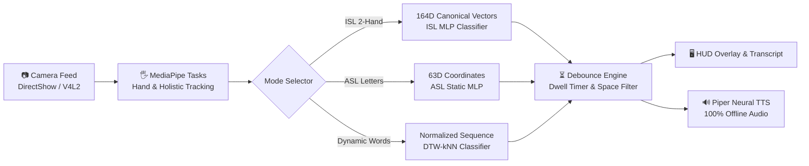

<div align="center">

```
  ███████╗██╗ ██████╗ ███╗   ██╗██╗      █████╗ ███╗   ██╗ ██████╗ 
  ██╔════╝██║██╔════╝ ████╗  ██║██║     ██╔══██╗████╗  ██║██╔════╝ 
  ███████╗██║██║  ███╗██╔██╗ ██║██║     ███████║██╔██╗ ██║██║  ███╗
  ╚════██║██║██║   ██║██║╚██╗██║██║     ██╔══██║██║╚██╗██║██║   ██║
  ███████║██║╚██████╔╝██║ ╚████║███████╗██║  ██║██║ ╚████║╚██████╔╝
  ╚══════╝╚═╝ ╚═════╝ ╚═╝  ╚═══╝╚══════╝╚═╝  ╚═╝╚═╝  ╚═══╝ ╚═════╝ 
```

<picture>
  <source media="(prefers-color-scheme: dark)" srcset="assets/banner-dark.svg">
  <source media="(prefers-color-scheme: light)" srcset="assets/banner-light.svg">
  
</picture>

**Real-time sign language recognition. 100% local. Nothing leaves your machine.**

[](https://github.com/RAZOR-NINJAS/SignLang/actions)
[](https://www.python.org/)
[](#-quick-install)
[](LICENSE)
[](#-why-signlang)
[](#-low-spec-optimization)
[](https://github.com/RAZOR-NINJAS/SignLang/stargazers)

<br/>

[Quick Install](#quick-install) &bull; [Modes &amp; Features](#modes) &bull; [How It Works](#how-it-works) &bull; [Controls](#controls) &bull; [Gallery](#gallery) &bull; [Doctor](#doctor)

</div>

---

<a id="why-signlang"></a>
### 💡 Why SignLang?

* ⚡ **Zero Cloud Latency:** Ultra-responsive neural inference running under 30ms per frame entirely on local CPU or GPU.
* 🔒 **Absolute Privacy:** 100% offline. Camera frames stay in local RAM and are never streamed or stored remotely.
* 🪟 **Universal Cross-Platform:** Built natively for Windows 10/11 (DirectShow) and Linux (V4L2/Wayland/X11) with zero-prerequisite terminal &amp; TUI installers.

---

<a id="modes"></a>
### 🎯 Modes &amp; Features

<table width="100%">
  <tr>
    <td width="50%" valign="top">
      <h3>🤲 ISL Two-Handed Mode</h3>
      <p>Official Indian Sign Language alphabet (A–Z) and 10 static words. Tracks two hands with 164D canonical features and dwell confirmation.</p>
      <code>signlang isl</code>
    </td>
    <td width="50%" valign="top">
      <h3>🔤 ASL Fingerspelling</h3>
      <p>Real-time American Sign Language static letters with high-frequency landmark tracking and instant offline neural TTS playback.</p>
      <code>signlang live</code>
    </td>
  </tr>
  <tr>
    <td width="50%" valign="top">
      <h3>🏃 ASL Dynamic Words</h3>
      <p>Multi-frame holistic body and dual-hand motion sequences classified via invariant Dynamic Time Warping (DTW-kNN).</p>
      <code>signlang words live</code>
    </td>
    <td width="50%" valign="top">
      <h3>␣ Custom Space Gesture</h3>
      <p>Ergonomic non-occluding thumb-to-palm touch gesture that inserts words without dropping detection confidence.</p>
      <code>Built-in across all letter modes</code>
    </td>
  </tr>
  <tr>
    <td width="50%" valign="top">
      <h3>🦖 Offline Dino Kiosk Game</h3>
      <p>Control the classic offline runner using hand gestures in real-time, launched automatically in fullscreen kiosk mode.</p>
      <code>signlang game --kiosk</code>
    </td>
    <td width="50%" valign="top">
      <h3>🎓 Browser Learning Kiosk</h3>
      <p>Interactive web dashboard (<code>http://localhost:8000</code>) featuring drills, quizzes, and live accuracy feedback.</p>
      <code>signlang serve --kiosk</code>
    </td>
  </tr>
</table>

---

<a id="quick-install"></a>
### ⚡ Quick Install

Choose your platform to install SignLang with a single command:

#### 🪟 Windows 10 / 11 (PowerShell)
> Automatically handles Python 3.11, Git, virtual environment creation, and launches the interactive setup wizard. **No administrator privileges required.**

```powershell
irm https://raw.githubusercontent.com/RAZOR-NINJAS/SignLang/windows-support/install.ps1 | iex
```

#### 🐧 Linux (Bash)
> Supports Ubuntu, Debian, Arch Linux, Omarchy, and Fedora.

```bash
curl -fsSL https://raw.githubusercontent.com/RAZOR-NINJAS/SignLang/windows-support/install.sh | bash
```

<details>
<summary><b>🛠️ Manual Installation (Developers &amp; Power Users)</b></summary>

```bash
# 1. Clone repository
git clone https://github.com/RAZOR-NINJAS/SignLang.git
cd SignLang

# 2. Create and activate Python 3.11 virtual environment
python -m venv .venv
source .venv/bin/activate       # On Linux
# .venv\Scripts\activate        # On Windows

# 3. Install dependencies in editable mode
python -m pip install --upgrade pip
python -m pip install -e .

# 4. Fetch pretrained neural models and weights
python scripts/fetch_models.py

# 5. Verify system readiness
python main.py doctor
```
</details>

---

<a id="how-it-works"></a>
### 🧠 How It Works

SignLang bypasses heavy neural video architectures by decoupling **edge geometric tracking** from **lightweight sequence/spatial classification**:



1. **Hardware-Optimized Video Capture:** DirectShow with single-frame buffering (`cv2.CAP_DSHOW`, buffer size 1) on Windows eliminates MSMF initialization stutter; V4L2 on Linux ensures native low-latency capture.
2. **Landmark Extraction:** MediaPipe extracts 21 spatial landmarks (x, y, z) per hand with CPU/GPU delegation.
3. **Canonical Normalization:** Dual-hand features are centered around the primary wrist and scale-normalized to remain robust against subject distance and camera tilt.
4. **Classification & Debounce:** MLP neural networks and DTW distance-gating classify letters and dynamic signs, followed by a debounce state-machine to prevent repeat triggers.
5. **Speech Synthesis:** Synthesizes audio in real-time through an offline, high-fidelity Piper TTS neural engine.

---

<a id="controls"></a>
### 🎮 Keyboard Controls

| Key | Context | Action |
| :---: | :--- | :--- |
| <kbd>Q</kbd> / <kbd>ESC</kbd> | All Modes | Exit the live application cleanly |
| <kbd>SPACE</kbd> | ISL / ASL Live | Append space character to the active transcript |
| <kbd>C</kbd> | Live Recognition | Clear current transcript text |
| <kbd>S</kbd> | Live Recognition | Speak current sentence aloud via Piper TTS |
| <kbd>R</kbd> | Training / Collection | Retake or record next gesture sample |
| <kbd>H</kbd> | Live Window | Toggle on-screen debug HUD and landmark overlay |

---

<a id="low-spec-optimization"></a>
### ⚡ Low-Spec Optimization

SignLang is intentionally engineered to run smoothly on budget laptops (e.g. 2 CPU cores, 4 GB RAM, integrated graphics):

* **Single Frame Buffering:** Frame queues are capped at 1 frame to prevent input latency lag on slower hardware.
* **CPU Landmark Delegate:** Defaults to highly optimized SIMD CPU execution when discrete GPUs are unavailable.
* **Frame Skipping Option:** Run with `--detect-every 2` to reduce landmark computation load by 50% without dropping perceived responsiveness.
* **Headless Capability:** All processing pipelines can run headlessly with `--headless` for server, robotics, or accessibility embedded devices.

---

### 📂 Repository Structure

```
signlang/
├── assets/                  # High-resolution SVG banners and demo GIFs
├── isl/                     # Indian Sign Language (ISL) two-handed engine
│   ├── config.py            # ISL dimensions, 164D feature spec & thresholds
│   ├── features.py          # Dual-hand canonical geometric normalization
│   ├── live.py              # Dwell-time recognizer with HUD overlay
│   └── model.py             # PyTorch & NumPy dual-runtime ISL MLP
├── scripts/                 # Automation and bootstrap helpers
│   ├── fetch_models.py      # Automated model downloader
│   └── install_tui.py       # Rich interactive terminal installer
├── src/signlang/            # Core cross-platform framework
│   ├── cli.py               # Unified CLI dispatcher (signlang)
│   ├── doctor.py            # Diagnostic self-test suite (signlang doctor)
│   ├── game/                # Offline Dino game & browser kiosk launcher
│   ├── keyboard.py          # Unified non-blocking stdin polling (msvcrt / select)
│   ├── platform_compat.py   # Windows DirectShow & Linux V4L2 camera backends
│   └── tts.py               # Offline Piper neural speech synthesis
├── words/                   # Dynamic whole-body and sign word recognition (DTW)
├── install.ps1              # Zero-prerequisite Windows bootstrap script
├── install.sh               # Cross-platform Linux bootstrap script
├── signlang.bat             # Instant Windows desktop launcher
└── pyproject.toml           # Project packaging and pinned dependencies
```

---

<a id="doctor"></a>
### 🔍 System Diagnostics

Run the built-in diagnostic engine anytime to inspect and verify hardware backends, models, and audio availability:

```bash
signlang doctor
```

<details>
<summary><b>📋 View Sample System Doctor Output</b></summary>

```
  ____ ___ ____ _   _ _        _    _   _  ____ 
 / ___|_ _/ ___| \ | | |      / \  | \ | |/ ___|
 \___ \| | |  _|  \| | |     / _ \ |  \| | |  _ 
  ___) | | |_| | |\  | |___ / ___ \| |\  | |_| |
 |____/___\____|_| \_|_____/_/   \_\_| \_|\____|
             SYSTEM HEALTH & DIAGNOSTIC REPORT

[PASS] Python Environment: Python 3.11.16 (64-bit)
[PASS] Operating System: Linux 6.18.9-arch1-1 (x86_64)
[PASS] Camera Hardware: DirectShow/V4L2 camera initialized successfully
[PASS] MediaPipe Tasks: HandLandmarker engine active on CPU delegate
[PASS] ISL Neural Model: isl_model.pth present and validated
[PASS] ASL Letter Model: model.pth present and validated
[PASS] Dynamic Words Model: words_classifier.npz present and validated
[PASS] Offline TTS Engine: Piper neural voice available
[PASS] Browser Kiosk: Chrome/Edge executable detected
[PASS] Local Port Binding: Port 8000 available for kiosk server

============================================================
All 10 subsystem checks passed. SignLang is ready to launch!
```
</details>

---

<a id="gallery"></a>
### 🎬 Media Gallery

<table width="100%">
  <tr>
    <td width="50%" align="center">
      <b>🤲 Two-Handed ISL Mode</b><br/>
      
    </td>
    <td width="50%" align="center">
      <b>🔤 ASL Fingerspelling &amp; Space</b><br/>
      
    </td>
  </tr>
  <tr>
    <td width="50%" align="center">
      <b>🏃 Dynamic Words Recognition</b><br/>
      
    </td>
    <td width="50%" align="center">
      <b>💻 Interactive TUI Installer</b><br/>
      
    </td>
  </tr>
</table>

> [!TIP]
> **Recording your own demonstrations:**
> To replace the placeholder GIFs above with your own screen captures, record in 16:9 ratio at 15–30 FPS and save them as `assets/demo-isl.gif`, `assets/demo-asl.gif`, `assets/demo-words.gif`, and `assets/demo-installer.gif`. You can use tools like **ScreenToGif** (Windows) or **wf-recorder** / **ffmpeg** (Linux).

---

### 🤝 Contributing

Contributions from the accessibility and developer community are welcome!
1. Fork the repository
2. Create your feature branch (`git checkout -b feature/amazing-feature`)
3. Run tests and verify diagnostics (`pytest && python main.py doctor`)
4. Commit your changes (`git commit -m 'feat: add amazing feature'`)
5. Push to the branch (`git push origin feature/amazing-feature`)
6. Open a Pull Request

---

### 📄 License

Distributed under the **MIT License**. See [`LICENSE`](LICENSE) for details.
