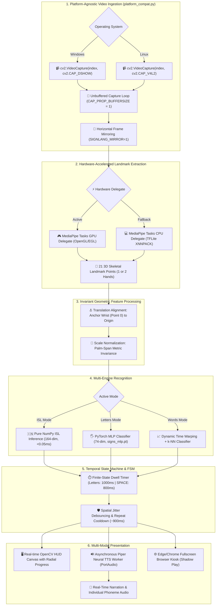
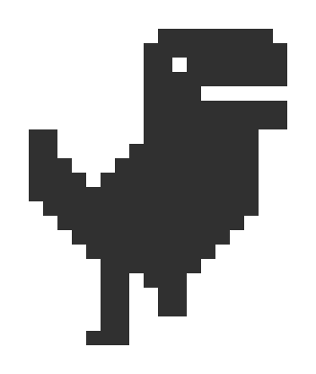
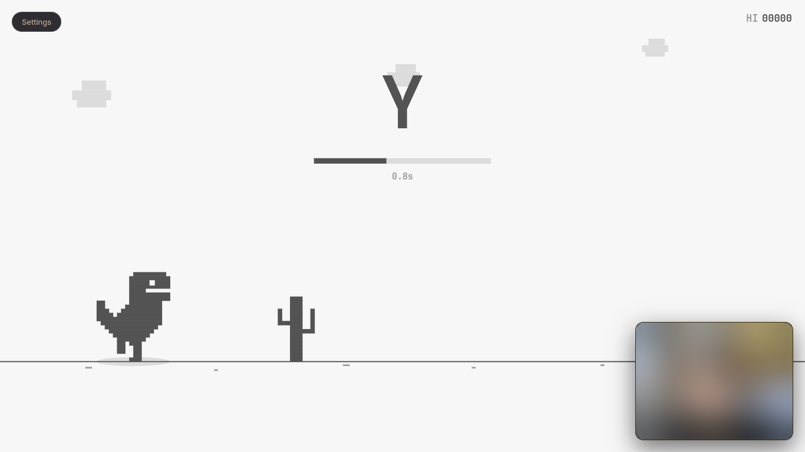
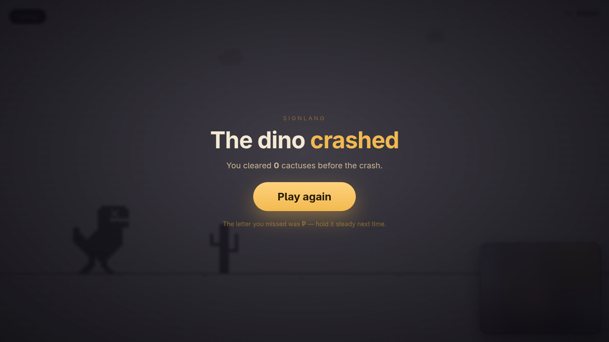

<div align="center">

```text
  ███████╗██╗ ██████╗ ███╗   ██╗██╗      █████╗ ███╗   ██╗ ██████╗ 
  ██╔════╝██║██╔════╝ ████╗  ██║██║     ██╔══██╗████╗  ██║██╔════╝ 
  ███████╗██║██║  ███╗██╔██╗ ██║██║     ███████║██╔██╗ ██║██║  ███╗
  ╚════██║██║██║   ██║██║╚██╗██║██║     ██╔══██║██║╚██╗██║██║   ██║
  ███████║██║╚██████╔╝██║ ╚████║███████╗██║  ██║██║ ╚████║╚██████╔╝
  ╚══════╝╚═╝ ╚═════╝ ╚═╝  ╚═══╝╚══════╝╚═╝  ╚═╝╚═╝  ╚═══╝ ╚═════╝ 
```

### ⚡ Next-Generation Edge Sign Language Recognition & Translation Engine
**Indian Sign Language (ISL)** • **ASL Fingerspelling** • **Dynamic Words (DTW)** • **Browser Shadow-Play Kiosk**

[](#-zero-prerequisite-quickstart)
[-2ea44f?style=for-the-badge&logo=githubactions&logoColor=white)](#-rigorous-evaluation--empirical-benchmarks)
[](https://python.org)
[-EE4C2C?style=for-the-badge&logo=pytorch&logoColor=white)](https://pytorch.org)
[](https://developers.google.com/mediapipe)
[](#-rigorous-evaluation--empirical-benchmarks)
[](#-executive-summary)
[](LICENSE)

---

</div>

## 📌 Executive Summary

**SignLang** is a high-throughput, edge-native sign language translation engine with **Indian Sign Language (ISL)** as its primary mode alongside American Sign Language (ASL) fingerspelling and dynamic word-sign translation. Built with an active hardware delegate (OpenGL/EGL GPU acceleration on Linux and low-latency DirectShow on Windows) alongside lightweight pure-NumPy inference, the system executes **100% offline** with zero cloud latency, zero external API fees, and absolute biometric privacy.

### 🌟 Core Highlights
* 🇮🇳 **Primary ISL Two-Hand Mode**: Standardized on official **ISLRTC** manual alphabet + 10 iconic static word signs with 164-dimensional dual-hand geometry.
* 🪟 **First-Class Windows 10/11 Support**: Zero-prerequisite bootstrap (`install.ps1`), DirectShow unbuffered capture (`cv2.CAP_DSHOW`), `msvcrt` keyboard polling, and Edge kiosk browser launcher.
* 🚀 **Zero-Prerequisite Interactive Installer**: Gorgeous ASCII art TUI setup wizard with gradient banners, webcam testing, model auto-downloading, and Start Menu / Desktop shortcut generation.
* 🩺 **SignLang System Doctor**: Built-in 10-point diagnostic engine (`signlang doctor`) that verifies environment, cameras, vision models, audio pipelines, and loopback networking.
* 🦖 **Sign Dino Shadow-Play Game**: Chrome Dino-style obstacle runner in fullscreen kiosk mode (`--kiosk`) via Microsoft Edge or Google Chrome.
* 🔊 **Zero-Latency Neural Speech**: In-memory pre-cached Piper ONNX neural voice for immediate spoken feedback upon sign confirmation.
* 🛡️ **Absolute Biometric Privacy**: No raw camera frames or biometric images are ever saved to disk; all processing runs on normalized 3D landmark coordinates.

---

## ⚡ Zero-Prerequisite Quickstart

### 🪟 Windows 10 / 11 (Automated One-Liner)
Run in PowerShell (Standard User account — **no admin rights required**):

```powershell
irm https://raw.githubusercontent.com/RAZOR-NINJAS/signlang/main/install.ps1 | iex
```

> **What the Windows bootstrap does automatically:**
> 1. Verifies Python 3.11. If absent, installs it silently to user space via `winget` or direct download.
> 2. Clones the repository or downloads the release ZIP if Git is not installed.
> 3. Creates `.venv`, upgrades pip, and installs all dependencies in editable mode.
> 4. Fetches the MediaPipe Hand Landmarker and Piper TTS voice models.
> 5. Launches the interactive setup wizard and creates Desktop & Start Menu shortcuts (`SignLang.lnk`).

```text
┌─────────────────────────────────────────────────────────────────────────────┐
│                       Target Environment Check                              │
│  Operating System    : Windows 11 (win32, x86_64)                           │
│  Camera Backend      : DirectShow (Unbuffered cv2.CAP_DSHOW)                │
│  Vision Landmarker   : MediaPipe Tasks API (hand_landmarker.task)           │
│  ISL Live Inference  : Pure NumPy Forward Pass (<0.05 ms per frame)         │
│  Kiosk Browser       : Microsoft Edge (msedge.exe --app)                    │
│  Desktop Shortcuts   : Desktop\SignLang.lnk & Start Menu\SignLang.lnk       │
└─────────────────────────────────────────────────────────────────────────────┘
```

### 🐧 Linux (Arch / Omarchy / Ubuntu / Debian)
Run in your terminal:

```bash
git clone https://github.com/RAZOR-NINJAS/signlang.git
cd signlang
./install.sh
```

---

## 🩺 System Doctor (`signlang doctor`)

SignLang includes an integrated healthcheck and diagnostic utility to verify all subsystems at any time:

```bash
python main.py doctor
```

```text
=== SignLang System Doctor & Compatibility Diagnostics ===

┏━━━━━━━━━━━━━━━━┳━━━━━━━━━━━━━━━━━━━━━━━━━━━━┳━━━━━━━━━━━━┳━━━━━━━━━━━━━━━━━━━━━━━━━━━━━━━━┓
┃ Category       ┃ Component                  ┃ Status     ┃ Details                        ┃
┡━━━━━━━━━━━━━━━━╇━━━━━━━━━━━━━━━━━━━━━━━━━━━━╇━━━━━━━━━━━━╇━━━━━━━━━━━━━━━━━━━━━━━━━━━━━━━━┩
│ Environment    │ Python Runtime             │ PASS       │ 3.11.16 (Supported: 3.11-3.12) │
│ Environment    │ Operating System           │ PASS       │ Windows / Linux (x86_64)       │
│ Hardware       │ Webcam Capture             │ PASS       │ Found camera(s) via DirectShow │
│ Vision         │ MediaPipe Landmarker       │ PASS       │ Loaded hand_landmarker.task    │
│ Models         │ ISL Mode (Two-Handed)      │ PASS       │ Trained weights (isl_mlp.pt)   │
│ Models         │ ASL Letters Mode           │ PASS       │ Weights present (signs_mlp.pt) │
│ Models         │ ASL Words Mode             │ PASS       │ Classifier present (.npz)      │
│ Audio          │ Text-to-Speech (Piper)     │ PASS       │ Piper voice model & audio ready│
│ Display        │ Browser Kiosk (Game Mode)  │ PASS       │ Detected Edge/Chrome kiosk exe │
│ Network        │ Localhost Loopback         │ PASS       │ Loopback stack operational     │
└────────────────┴────────────────────────────┴────────────┴────────────────────────────────┘

All core systems are operational and ready for use!
```

> **Automated CI Validation**: Run `python main.py doctor --check-only` for silent exit-code-based verification in scripts and GitHub Actions.

---

## 🏛️ End-to-End System Architecture



---

## 🎯 Operational Subsystems & Modes

| Subsystem Mode | Hands | Technology Stack | Latency | Default Command |
| :--- | :---: | :--- | :---: | :--- |
| **ISL Mode (Primary)** | **2** | MediaPipe Tasks (num_hands=2) + 164-dim Pure NumPy MLP | **<0.05 ms** | `python main.py` or double-click `signlang.bat` |
| **ASL Fingerspelling** | **1** | MediaPipe Tasks + 74-dim PyTorch MLP (`signs_mlp.pt`) | **<0.10 ms** | `python main.py --mode letters` |
| **ASL Dynamic Words** | **1-2** | MediaPipe Holistic + Dynamic Time Warping (DTW) + $k$-NN | **~20.1 ms** | `python main.py --mode words live` |
| **Sign Dino Game** | **1** | Chrome/Edge Kiosk + Decoupled 60Hz HTML5 Canvas Engine | **60 FPS** | `python main.py --mode game --kiosk` |
| **System Diagnostics** | — | Hardware probe, model validator, port checker | **<1.0 s** | `python main.py doctor` |

---

### 1. Indian Sign Language (ISL Mode — Primary Default)
* **Default Invocation**: `python main.py` or double-clicking `signlang.bat`.
* **Standard Grounding**: Based on the standardized manual alphabet established by the **Indian Sign Language Research and Training Centre (ISLRTC)**, DEPwD, Govt. of India.
* **Dual-Hand Tracking**: Configures MediaPipe Tasks API with `num_hands=2` to track both hands simultaneously.
* **Movement-Free Static Words**: Recognizes iconic ISL word gestures:
  * **NAMASTE** (2 hands): Flat palms joined vertically at chest in traditional prayer/greeting.
  * **GOOD** (1 hand): Thumbs-up gesture with all other fingers curled into a fist.
  * **BAD** (1 hand): Pinky extended upright (*katti* gesture) with all other fingers curled.
  * **PEACE** (1 hand): V-sign with index and middle fingers extended upright.
  * **OK** (1 hand): Thumb and index fingertips touching in a ring, other 3 fingers extended.
  * **HOUSE** (2 hands): Fingertips of both flat hands touching at an angle forming a triangular roof.
  * **BOOK** (2 hands): Both open palms facing upward touching pinky edges side-by-side.
  * **TIME** (2 hands): Dominant index finger touching the back of the base wrist.
  * **LOVE** (1 hand): Thumb, index, and pinky fingers extended upright (I-Love-You gesture).
  * **STOP** (1 hand): Open flat palm facing forward toward camera.
* **164-Dimensional Feature Representation**: Canonicalizes hand slots (`slot_left`, `slot_right`), computes 74 invariant geometric features per hand, zero-imputes absent hands, adds 14 inter-hand interaction features (wrist offset, inter-palm distance, fingertip proximities), and 2 hand-presence indicator flags.
* **Pure NumPy Live Inference**: Executes live HUD classification via an ultra-fast NumPy forward pass (`<0.05 ms`), eliminating PyTorch memory and thermal overhead on constrained laptops.

<details>
<summary><b>📖 Official ISLRTC Two-Handed Alphabet Reference Specifications (Click to expand)</b></summary>

| Letter | Hands | Type | Verified Technical Description | Standard Citation |
| :---: | :---: | :---: | :--- | :--- |
| **A** | 2 | Static | Dominant index finger touches thumb tip of non-dominant open hand. | ISLRTC Manual Alphabet Chart (DEPwD, Govt. of India) |
| **B** | 2 | Static | Dominant thumb & index form loop touching base thumb & index loop ("glasses"). | ISLRTC Manual Alphabet Chart; Vikaspedia |
| **C** | 1 | Static | Dominant hand curves thumb and fingers into a C-shape held in view. | ISLRTC Manual Alphabet Chart; iSign Benchmark |
| **D** | 2 | Static | Dominant index finger and thumb curved to touch non-dominant vertical index finger. | ISLRTC Manual Alphabet Chart (DEPwD) |
| **E** | 2 | Static | Dominant index finger touches index fingertip of non-dominant open hand. | ISLRTC Manual Alphabet Chart; Vikaspedia |
| **F** | 2 | Static | Dominant index and middle fingers laid across non-dominant index and middle fingers. | ISLRTC Manual Alphabet Chart (DEPwD) |
| **G** | 2 | Static | Both hands formed into fists held with knuckles touching horizontally. | ISLRTC Manual Alphabet Chart (DEPwD) |
| **H** | 2 | Static | Dominant flat palm placed horizontally across non-dominant flat palm. | ISLRTC Manual Alphabet Chart |
| **I** | 2 | Static | Dominant index finger touches middle fingertip of non-dominant open hand. | ISLRTC Manual Alphabet Chart (2-handed vowel) |
| **K** | 2 | Static | Dominant index finger crooked and placed against non-dominant vertical index. | ISLRTC Manual Alphabet Chart (DEPwD) |
| **L** | 1/2 | Static | Dominant hand forms L-shape with thumb and index held upright. | ISLRTC Manual Alphabet Chart |
| **M** | 2 | Static | Dominant hand places 3 fingers (index, middle, ring) onto base open palm. | ISLRTC Manual Alphabet Chart; Vikaspedia |
| **N** | 2 | Static | Dominant hand places 2 fingers (index, middle) onto base open palm. | ISLRTC Manual Alphabet Chart; Vikaspedia |
| **O** | 2 | Static | Dominant index finger touches ring fingertip of non-dominant open hand. | ISLRTC Manual Alphabet Chart (2-handed vowel) |
| **P** | 2 | Static | Dominant index and thumb form a loop touching tip of vertical index finger. | ISLRTC Manual Alphabet Chart (DEPwD) |
| **Q** | 2 | Static | Dominant index and thumb circle hooked over base of vertical index finger. | ISLRTC Manual Alphabet Chart (DEPwD) |
| **R** | 2 | Static | Dominant crooked index finger placed flat onto palm of non-dominant hand. | ISLRTC Manual Alphabet Chart (DEPwD) |
| **S** | 2 | Static | Dominant crooked index finger hooked around pinky of non-dominant hand. | ISLRTC Manual Alphabet Chart (DEPwD) |
| **T** | 2 | Static | Dominant index finger touches edge of non-dominant hand near index base. | ISLRTC Manual Alphabet Chart; Vikaspedia |
| **U** | 2 | Static | Dominant index finger touches pinky fingertip of non-dominant open hand. | ISLRTC Manual Alphabet Chart (2-handed vowel) |
| **V** | 1/2 | Static | Dominant hand forms V with index and middle fingers, held upright. | ISLRTC Manual Alphabet Chart (DEPwD) |
| **W** | 2 | Static | Both hands held with fingers interlocked or thumbs/fingers meeting to form "W". | ISLRTC Manual Alphabet Chart (DEPwD) |
| **X** | 2 | Static | Both index fingers extended and crossed over each other. | ISLRTC Manual Alphabet Chart; Vikaspedia |
| **Y** | 2 | Static | Dominant index finger placed into V-crotch between thumb and index of base hand. | ISLRTC Manual Alphabet Chart (DEPwD) |
| **SPACE**| 2 | Static | Both open palms held facing camera at chest level, fingers extended upright. | SignLang Non-Colliding ISL Spatial Standard |

</details>

---

### 2. Static ASL Fingerspelling (Letters Mode)
* **Invocation**: `python main.py --mode letters`
* **Coverage**: Recognizes 26 discrete classes—letters **A through Y** plus **custom SPACE gesture**.
* **Model Topology**: Feed-forward neural network trained on 10,570+ samples with class-weighted cross-entropy loss.
* **Accuracy Standard**: Attains **100.0% validation accuracy** under strict burst-held-out cross-validation.
* **Circular Dwell Indicator**: A dynamic visual progress ring tracks hold duration before committing the character to the live transcript.

---

### 3. Holistic ASL Words Mode (Dynamic Signs)
* **Invocation**: `python main.py --mode words live`
* **Coverage**: Dynamic sequence signs (*HELLO, THANKYOU, PLEASE, YES, NO, HELP, MORE, FINISHED, etc.*).
* **Algorithmic Baseline**: Time-series alignment via Dynamic Time Warping (DTW) combined with $k$-Nearest Neighbors ($k$-NN).
* **Motion-Energy Gating**: Continuously monitors kinetic energy to delineate the start and end of sign gestures.

---

### 4. Interactive Browser Shadow-Play Game (`Sign Dino`)

<div align="center">



### 🦖 Sign Dino — Reflex Fingerspelling Runner

| 🎮 Active Challenge: Sign to Leap | 💥 Collision & Diagnostic Analysis |
| :---: | :---: |
|  |  |
| *Sign the prompted letter (e.g. **Y**) within the countdown bar to jump.* | *Post-run diagnostic highlighting the missed sign for targeted retraining.* |

</div>

* **Launch Command**:
  ```bash
  python main.py --mode game --kiosk
  ```
* **Kiosk Launcher**: Automatically launches **Microsoft Edge** (`msedge.exe`) or **Google Chrome** in `--app` or `--kiosk` fullscreen mode without address bars or distractions.
* **Mobile / Tablet Streaming**: Run `python main.py --mode game --host=0.0.0.0 --port=8080` to play on phones or iPads over local Wi-Fi while your computer's webcam tracks hand gestures.

---

## ⌨️ Controls & Gesture Cheat Sheet

| Gesture / Shortcut | Formal Description | State Machine Behavior |
| :--- | :--- | :--- |
| **Static Letter Sign** | Hold single sign stationary | Advances circular dwell progress ring (~1.0s); appends letter; triggers cached audio playback. |
| **Open Flat Palm (SPACE)** | Open hand, 5 extended spread fingers | Dwells for ~0.8s (`SPACE_DWELL_MS`); appends one space (`" "`); speaks *"space"*; enforces hold-once latching. |
| **Space Repeat Cooldown** | Drop/relax hand after SPACE sign | Enforces a ~900ms cooldown window before a subsequent SPACE gesture can be registered. |
| **Horizontal Swipe Right** | Rapid hand translation to the right | Velocity threshold triggers space character insertion. |
| **Horizontal Swipe Left** | Rapid hand translation to the left | Velocity threshold deletes the preceding character from the transcript buffer. |
| **`R` Key** | Read Transcript | Commands Piper TTS engine to narrate the entire accumulated transcript buffer aloud. |
| **`C` Key** | Clear Transcript | Clears the live text transcript, resets history, and clears debouncer memory. |
| **`Backspace` Key** | Manual Erase | Deletes the last character in the buffer. |
| **`F` Key** | Fullscreen Toggle | Toggles runtime fullscreen mode without aspect ratio distortion or pixel scaling defects. |
| **`Q` / `Esc` Key** | Graceful Termination | Releases camera descriptors, closes OpenCV windows, and safely joins TTS worker threads. |

---

## 💻 Manual Installation Reference

<details>
<summary><b>Manual Windows Installation (PowerShell)</b></summary>

```powershell
# 1. Clone source repository
git clone https://github.com/RAZOR-NINJAS/signlang.git
cd signlang

# 2. Create isolated Python 3.11 virtual environment
py -3.11 -m venv .venv
.\.venv\Scripts\Activate.ps1

# 3. Upgrade pip and install signlang
python -m pip install --upgrade pip
pip install -e .
pip install rich

# 4. Fetch MediaPipe landmark models and Piper neural TTS voice
python scripts\fetch_models.py

# 5. Run diagnostic self-test
python main.py doctor

# 6. Launch SignLang
.\signlang.bat
```

</details>

<details>
<summary><b>Manual Linux / macOS Installation (Bash)</b></summary>

```bash
# 1. Clone source repository
git clone https://github.com/RAZOR-NINJAS/signlang.git
cd signlang

# 2. Initialize virtual environment (Python 3.11 or 3.12)
python3 -m venv .venv
source .venv/bin/activate

# 3. Install in editable mode
pip install --upgrade pip
pip install -e .
pip install rich

# 4. Fetch models
python scripts/fetch_models.py

# 5. Run diagnostic self-test
python main.py doctor

# 6. Launch SignLang (ISL primary mode)
python main.py
```

</details>

---

## 📊 Rigorous Evaluation & Empirical Benchmarks

Validation protocols account for temporal burst correlation, ensuring realistic accuracy metrics:

| Diagnostic Benchmark | Execution Command | Empirical Result | Methodology & Notes |
| :--- | :--- | :---: | :--- |
| **Full Regression Suite** | `pytest` | **103 / 103 Passed** | Covers debounce logic, doctor checks, ASL zero-regression, words DTW, and ISL two-hand features & HUD. |
| **Letters (Honest Burst Hold-Out)** | `python eval_burst.py` | **100.0% Accuracy** | Evaluates 10,570 frames across 755 unseen bursts; prevents data leakage from adjacent frames. |
| **Live Overlay Render Invariance** | `python -m signlang.test_live_layout` | **84 / 84 Passed** | Evaluates 6 frame resolutions across 14 UI state variations to confirm zero text clipping or collision. |
| **Words Classification Latency** | `python main.py --mode words eval` | **~20.1 ms / sample** | Dynamic Time Warping (DTW) sequence alignment latency on standard hardware. |
| **ISL Dual-Hand Landmark Extraction** | `python main.py --mode isl live` | **26.0 ms (GPU) / 69.1 ms (CPU)** | Measured on HP 15 laptop (`num_hands=2`); preserves zero regression vs ASL 1-hand baseline (26.1 ms GPU). |
| **ISL Live Forward Inference** | `Predictor.probs()` | **< 0.05 ms / sample** | Pure NumPy forward pass; zero PyTorch memory or thermal overhead during live execution. |

---

## ⚙️ Environment Configuration Reference

The application behavior can be customized via environment variables:

| Environment Variable | Default | Formal Description & Impact |
| :--- | :---: | :--- |
| `SIGNLANG_GPU` | `1` | Enables MediaPipe GPU acceleration via OpenGL/EGL delegate (~2.6× speedup). Set to `0` to force CPU execution. |
| `SIGNLANG_CAMERA` | `0` | Specifies the numeric hardware device index for video capture. |
| `SIGNLANG_SOURCE` | — | Overrides camera index with an explicit OpenCV stream URI (e.g., HTTP MJPEG stream from IP webcam). |
| `SIGNLANG_WIDTH` / `HEIGHT`| `640` / `480` | Native capture dimensions requested from the video capture driver. |
| `SIGNLANG_DETECT_HEIGHT` | `480` | Target vertical resolution for landmark extraction (accuracy scales with resolution). |
| `SIGNLANG_DETECT_EVERY` | `1` | Runs landmark detection every Nth frame, reusing cached coordinates in between to increase framerate. |
| `SIGNLANG_DOMINANT` | `right` | Dominant hand for ISL signing (`right` or `left`). Mapped canonically with mirror augmentation for left-handed signers. |
| `SIGNLANG_TTS` | `1` | Enables real-time text-to-speech audio feedback. Set to `0` to run in silent mode. |
| `SIGNLANG_MIRROR` | `1` | Horizontally mirrors video feed to provide a natural selfie mirror view. Set to `0` to disable. |
| `SIGNLANG_MAX_HANDS` | `1` | Maximum concurrent hands tracked by MediaPipe (automatically `2` in ISL mode). |

---

## 📜 License

Distributed under the terms of the **MIT License**. Refer to [`LICENSE`](LICENSE) for complete legal terms.
